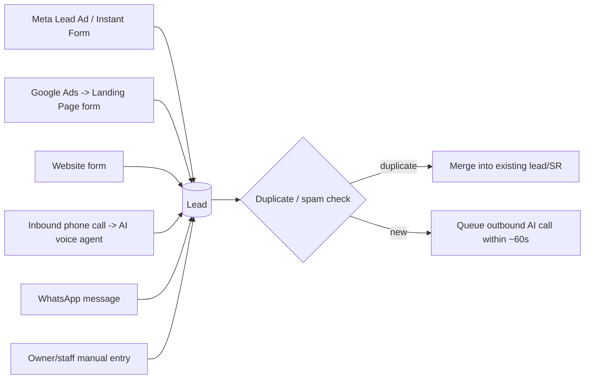
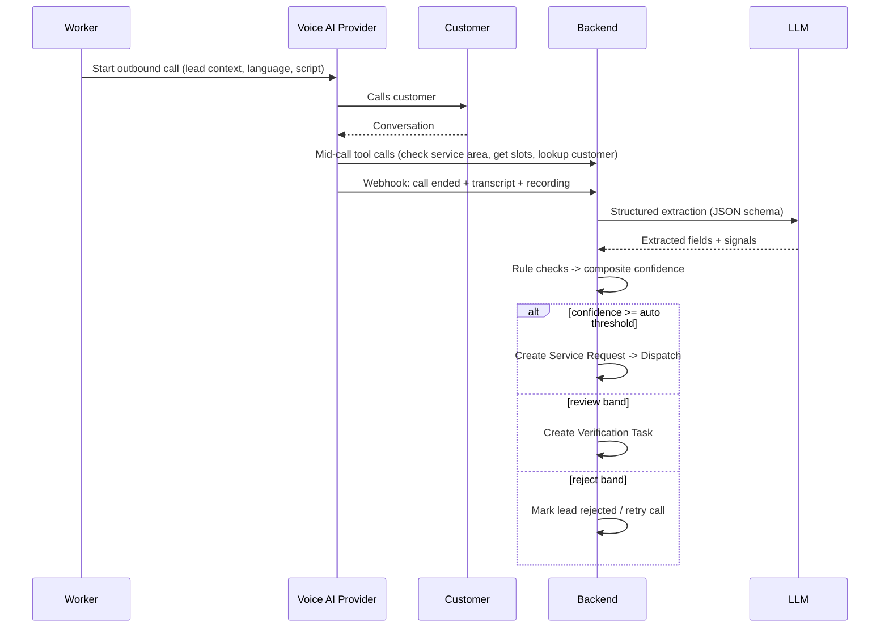
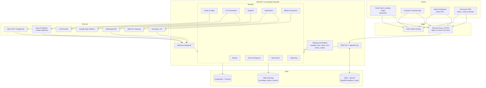
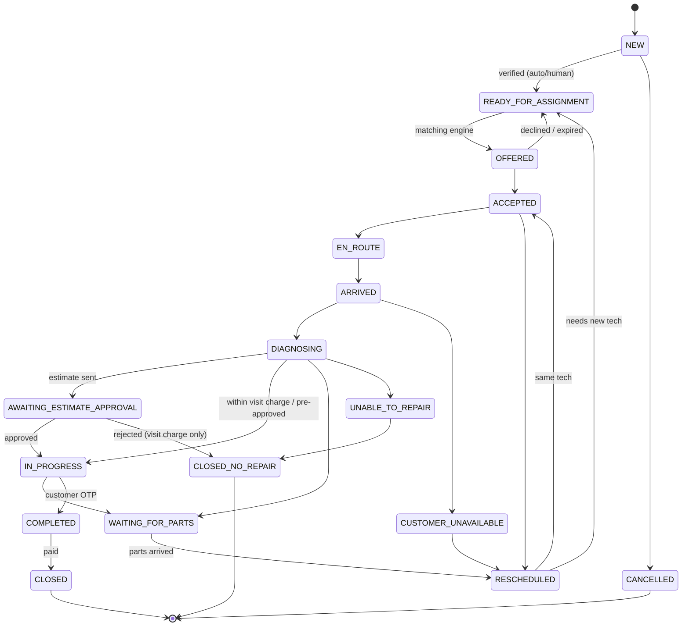

# AI-Powered Service Management & Technician Dispatch Platform
### Architecture, Database Design, Tech Stack & Delivery Plan

> **One-line product definition**
> A platform that captures repair leads (ads, website, calls, WhatsApp), qualifies them through an AI voice agent, turns them into structured service requests, assigns the best technician automatically, tracks every job to completion, and keeps the customer and owner updated without manual phone calls.

---

## Table of Contents
1. [Analysis of the Idea](#1-analysis-of-the-idea)
2. [Scope & Guiding Principles](#2-scope--guiding-principles)
3. [Users & Roles](#3-users--roles)
4. [Core Workflows](#4-core-workflows)
5. [System Architecture](#5-system-architecture)
6. [Tech Stack](#6-tech-stack)
7. [Database Design](#7-database-design)
8. [Service Request State Machine](#8-service-request-state-machine)
9. [AI Design: Intake, Extraction & Confidence](#9-ai-design-intake-extraction--confidence)
10. [Technician Matching Engine](#10-technician-matching-engine)
11. [Notifications & Communication](#11-notifications--communication)
12. [API Design](#12-api-design)
13. [Project Structure](#13-project-structure)
14. [Security, Compliance & Privacy](#14-security-compliance--privacy)
15. [Infrastructure, DevOps & Observability](#15-infrastructure-devops--observability)
16. [Delivery Roadmap](#16-delivery-roadmap)
17. [Risks & Mitigations](#17-risks--mitigations)
18. [Open Questions for the Business Owner](#18-open-questions-for-the-business-owner)

---

## 1. Analysis of the Idea

### 1.1 What's strong
| Strength | Why it matters |
|---|---|
| **Existing business** (customers, technicians, demand) | No cold-start problem. Real jobs exist on day 1 to test against. |
| **Automates a proven process** | Requirements come from what the owner already does, so less guesswork. |
| **Human-in-the-loop via confidence scores** | AI mistakes go to a person for review instead of reaching a technician. |
| **PWA instead of native apps** | One codebase covers customer, technician and admin. Much lower cost. |
| **Phased rollout** | You can get value from digitising operations before any AI is built. |

### 1.2 Gaps found in the original idea (and how this plan fills them)
| Gap | Risk if ignored | Addressed in |
|---|---|---|
| **Only ad leads considered.** Many customers will call the shop, send a WhatsApp message, or be repeat customers. | Two systems running side by side, and the owner keeps using the old one. | Multi-channel intake (§4.1). Every channel creates a `lead`. |
| **Language.** In Hyderabad, many customers and technicians prefer Telugu or Hindi. | The AI call fails, confidence drops and the review queue overflows. | Multilingual voice agent + i18n UI (§6, §9). |
| **An LLM's self-reported confidence can't be trusted.** | Bad jobs get auto-assigned. | Composite score: deterministic checks + LLM signals (§9.3). |
| **No pricing/estimate approval step.** | Disputes about what the repair costs. Biggest trust problem in this industry. | Estimate approval by the customer via a WhatsApp link (§4.4). |
| **No proof of completion.** | Fake "completed" jobs, and technicians collecting cash off the books. | Completion OTP + before/after photos (§4.4). |
| **Payments & cash handling.** Technicians often collect cash. | Money goes missing and can't be reconciled. | Payments + technician cash ledger (§7.9). |
| **Repeat/warranty visits.** | Free re-visits are hard to track, and they're the main quality signal. | `parent_service_request_id` + appliance history (§7.5). |
| **Ad-spend feedback loop.** | Meta/Google optimise for form fills, not real jobs. | Send "qualified" and "completed" events back via Meta Conversions API / Google offline conversions (§11.4). |
| **Lead duplicates & spam.** | Paying for AI calls on junk leads. | Phone normalisation, de-duplication window, spam flags (§9.2). |
| **Indian regulatory constraints** (DPDP Act 2023, TRAI/DLT SMS rules, WhatsApp template approval, call-recording consent). | Blocked messaging, legal exposure. | §14. |
| **Technician tech-literacy.** | Low adoption of the app. Technicians go back to phoning the owner. | Big-button PWA in their language, plus a WhatsApp reply fallback for status updates (§11.3). |
| **Future SaaS potential.** Other repair shops have the same problem. | Expensive rewrite later. | A `tenant_id` on every business table from day 1. Cheap now, very costly later (§7.1). |

### 1.3 Verdict
The idea is viable and well-scoped **if** the rollout is **"digitise first, automate second, AI third."** Phase 1 alone (dashboard + technician PWA + WhatsApp notifications) removes most of the owner's daily phone calls and gives the AI phases clean data to work from.

---

## 2. Scope & Guiding Principles

1. **AI proposes, rules validate, humans handle exceptions.** AI never takes an irreversible action (assignment, cancellation, charging) without a deterministic rule check passing.
2. **Every action is an event.** All status changes go through one state machine and get written to history. The dashboard, notifications and analytics are all built from those events.
3. **Modular monolith, not microservices.** One deployable .NET app with strict module boundaries. You can split it later if you need to. You almost certainly won't at this scale.
4. **Providers behind interfaces.** Voice AI, LLM, WhatsApp, SMS, Maps and Payments each sit behind an `IProvider` abstraction, so you can switch vendors on cost or quality.
5. **Configurable, not hard-coded.** Confidence thresholds, SLA timers, assignment weights and visit charges live in a `settings` table the owner can edit.
6. **Mobile-first.** Technicians and customers use phones. The owner may use either.
7. **Idempotent integrations.** Webhooks (voice, WhatsApp, payments) can arrive twice or out of order, so every handler is idempotent.

---

## 3. Users & Roles

| Role | Primary surface | Key capabilities |
|---|---|---|
| **Owner / Admin** | Admin dashboard (desktop + mobile) | Everything: settings, technicians, pricing, reports, overrides |
| **Dispatcher / Verifier** *(optional staff)* | Admin dashboard (limited) | Verification queue, manual assignment, customer calls |
| **Technician** | Technician PWA | View/accept jobs, update status, upload photos, raise estimates, request parts, collect payment |
| **Customer** | Public site + tracking page (no login; magic link/OTP) + WhatsApp | Request service, track status, approve estimate, pay, rate |
| **System / AI agents** | Background workers | Calls, analysis, matching, follow-ups, notifications |

Auth model:
- **Admin/Staff:** email + password, optional TOTP 2FA.
- **Technician:** phone + OTP, long-lived refresh token (they shouldn't have to log in every day).
- **Customer:** no account. A signed, expiring tracking link (`/t/{token}`) is sent on WhatsApp/SMS. Phone OTP only for sensitive actions like approving an estimate or paying.

---

## 4. Core Workflows

### 4.1 Lead intake (multi-channel)

- Capture **UTM params, gclid, fbclid, campaign/ad IDs** on every lead for attribution.
- Show an explicit **consent checkbox** on forms: "I agree to receive a call / WhatsApp about my request; calls may be recorded."
- **Speed to lead:** the AI call should start within 1–2 minutes. Conversion falls sharply after that.
- Calling window: within business hours (configurable, e.g., 8am–9pm). Outside it, send a WhatsApp acknowledgement and schedule the call.

### 4.2 AI qualification

- **Retries:** no answer leads to a WhatsApp message ("We tried calling you…") and a retry after 15 min, then after 2 h. Max 3 attempts (configurable).
- During the call, the voice agent can call **backend tools** (function calling) to check whether a pincode is serviceable, read available slots, and look up past jobs for this phone number. This makes the call far more accurate than a fixed script.

### 4.3 Dispatch
1. SR enters `READY_FOR_ASSIGNMENT`.
2. The matching engine ranks eligible technicians (§10).
3. The top candidate gets an **offer** (push + WhatsApp) with an acceptance timeout (e.g., 10 min).
4. If the technician declines or the timeout passes, the offer goes to the next candidate. After N failures, the job is escalated to the owner.
5. The owner can always override (manual assign / reassign).

### 4.4 Job execution
```text
Assigned → Accepted → En Route → Arrived → Diagnosing
   → Estimate Sent → Estimate Approved → Repair In Progress
   → Completed (customer OTP) → Paid → Closed
```
- **Estimate:** the technician enters labour + parts. The customer gets a WhatsApp link and approves with one tap (and OTP for amounts above a threshold). This prevents disputes.
- **Completion OTP:** a 4-digit code is sent to the customer at "Arrived". The technician enters it to mark the job complete. This proves the visit happened and the work was accepted.
- **Photos:** before/after photos are required for completion (configurable per category).
- **Exceptions:** Customer Not Available, Needs Spare Part, Unable To Repair, Rescheduled, Cancelled, Technician Delayed. Each one has a reason code and its own follow-up rule.

### 4.5 Follow-up & escalation (SLA engine)
| Rule (examples, configurable) | Action |
|---|---|
| Offer not accepted in 10 min | Re-offer to next technician |
| Accepted but not "En Route" 30 min before slot | WhatsApp nudge to technician |
| No status update for 3 h while In Progress | AI/WhatsApp check-in to technician → parse reply → update status |
| "Waiting for Spare Part" > 48 h | Escalate to owner, notify customer of delay |
| Completed but unpaid > 24 h | Payment reminder to customer |
| Completed | Feedback request after 2 h |
| Completed | Maintenance reminder after 6 months (AC service, etc.) for repeat business |

---

## 5. System Architecture

### 5.1 High-level view


### 5.2 Key architectural patterns
| Pattern | Where | Why |
|---|---|---|
| **Modular monolith** | Backend | One deploy, one DB, clear boundaries. Each module owns its own tables and exposes an application-service interface. |
| **State machine** (`Stateless` library) | Service Requests | Blocks illegal transitions such as Completed → Assigned. Single place for side effects. |
| **Domain events + Transactional Outbox** | All modules | A status change and its "send WhatsApp" event commit in the same transaction, so messages aren't lost or sent twice. |
| **Idempotent webhook inbox** | Webhooks | `webhook_events` table with a unique `(provider, event_id)`. Duplicates are ignored. |
| **Background jobs** (Hangfire on PostgreSQL) | AI calls, retries, SLA timers, notifications | Durable, retryable, with a built-in dashboard. No extra infrastructure. |
| **CQRS-lite** | Dashboard | Commands through domain services. Reads through optimised queries/views (Dapper or EF projections). |
| **Real-time push** (SignalR) | Admin board, technician app | Board updates instantly when a technician changes status. |
| **Strategy pattern** | Matching engine, confidence scorer | Weights/rules can be swapped and A/B tested. |
| **Anti-corruption layer** | Every external provider | Vendor payloads are mapped to internal models at the edge. |

### 5.3 Event flow example: "Technician marks En Route"
```text
PWA → PATCH /api/tech/jobs/{id}/status {to: EN_ROUTE, lat, lng}
  → ServiceRequest.Transition(EN_ROUTE)        (state machine validates)
  → INSERT service_status_history
  → INSERT outbox_messages [SrStatusChanged]   (same transaction)
COMMIT
Outbox worker →
  → SignalR: push to admin board + customer tracking page
  → Notifications: WhatsApp "Ravi is on the way, ETA ~25 min" (ETA via Maps)
  → SLA engine: cancel "not en route" timer, start "arrival" timer
```

---

## 6. Tech Stack

### 6.1 Frontend
| Concern | Choice | Notes |
|---|---|---|
| Framework | **React 19 + TypeScript + Vite** | Matches existing skills |
| Monorepo | **pnpm workspaces** (+ Turborepo optional) | Shared UI, types, API client |
| Styling / UI | **Tailwind CSS + shadcn/ui** | Fast, accessible components |
| Server state | **TanStack Query** | Caching, optimistic updates |
| Client state | **Zustand** (minimal) | Only for UI state |
| Routing | **React Router** | |
| Forms & validation | **React Hook Form + Zod** | |
| API client | **Orval** (generated from OpenAPI) | Typed client + React Query hooks, never out of sync |
| Real-time | **@microsoft/signalr** | |
| PWA | **vite-plugin-pwa** (Workbox) | Installable, offline queue for status updates, push notifications |
| i18n | **i18next** | English, Telugu, Hindi |
| Maps | **Google Maps JS API** (`@vis.gl/react-google-maps`) | Technician map, address pin |
| Tables / Kanban | **TanStack Table**, **dnd-kit** | Live service board, drag-to-reassign |
| Charts | **Recharts** | Reports |
| Testing | **Vitest + React Testing Library + Playwright** | |

> **Landing pages:** Ad landing pages must load in under 2 s on 4G. Keep them as a separate, very light app (or static pages built with Vite/Astro). Don't ship the admin bundle to ad traffic.

### 6.2 Backend
| Concern | Choice | Notes |
|---|---|---|
| Runtime | **.NET 9/10 (LTS where available), ASP.NET Core Web API** | Minimal APIs or controllers. Pick one and stay consistent |
| ORM | **EF Core + Npgsql** (+ **Dapper** for heavy dashboard queries) | |
| Spatial | **PostGIS + NetTopologySuite** | Distance queries, service-area polygons |
| Validation | **FluentValidation** | |
| In-process messaging | **MediatR** (or plain application services) | Keep it simple |
| State machine | **Stateless** | SR lifecycle |
| Background jobs | **Hangfire** (PostgreSQL storage) | Retries, delayed jobs, cron (SLA scans) |
| Real-time | **SignalR** (+ Redis backplane once you run >1 instance) | |
| Auth | **ASP.NET Core Identity + JWT (access) + refresh tokens** | OTP via SMS/WhatsApp provider |
| Resilience | **Polly** via `Microsoft.Extensions.Http.Resilience` | Retries/circuit breakers for providers |
| Logging | **Serilog** → Seq (dev) / Application Insights or Grafana Loki (prod) | Structured logs with `ServiceRequestId` correlation |
| Tracing/metrics | **OpenTelemetry** | |
| API docs | **OpenAPI (Swashbuckle / built-in) + Scalar UI** | Source for Orval client generation |
| PDFs | **QuestPDF** | Invoices, job cards |
| Testing | **xUnit + FluentAssertions + Testcontainers (PostgreSQL)** | Real DB in integration tests |

### 6.3 Data & storage
| Concern | Choice |
|---|---|
| Primary DB | **PostgreSQL 16+** with **PostGIS** |
| Object storage | **Azure Blob Storage** or **S3-compatible** (Cloudflare R2, AWS S3 Mumbai) |
| Cache / backplane | **Redis** (only when needed) |
| Search (later) | PostgreSQL full-text + `pg_trgm` for customer/phone search. No Elasticsearch needed |

### 6.4 External services (shortlist; evaluate before committing)
| Capability | Options | Selection criteria |
|---|---|---|
| **Voice AI agent** | Vapi, Retell AI, Bolna (India-focused), ElevenLabs Agents, custom (LiveKit Agents + STT/TTS) | **Telugu/Hindi quality**, latency, tool-calling, webhook transcripts, ₹/min, Indian number support |
| **Indian telephony** | Exotel, Plivo, Knowlarity, Twilio (check India outbound restrictions) | Local DID, outbound to Indian mobiles, SIP integration with voice platform |
| **Speech (if building custom)** | Sarvam AI, Deepgram, Google STT; ElevenLabs / Sarvam TTS | Indian-language accuracy |
| **LLM** (extraction, analysis, follow-up parsing) | Claude (Sonnet-class for extraction, Haiku-class for cheap classification), OpenAI, Gemini | Structured-output reliability, cost, Indic language handling |
| **WhatsApp** | Meta Cloud API direct, or BSP: Gupshup, Interakt, AiSensy, Twilio | Template approval speed, pricing, webhook reliability |
| **SMS (OTP, fallback)** | MSG91, Gupshup, Kaleyra (DLT-registered) | DLT compliance |
| **Maps** | Google Maps Platform (Geocoding, Places Autocomplete, Distance Matrix / Routes) | Accuracy in Indian addresses |
| **Payments** | **Razorpay** (UPI, payment links, QR), Cashfree, PhonePe PG | UPI payment links via WhatsApp |
| **Push** | Web Push (VAPID) from the PWA; FCM optional | Free |
| **Email** (low priority) | Resend / SendGrid / AWS SES | |

> **Recommendation:** Run a **2-week voice provider bake-off** with 30–50 real (consented) calls in Telugu, Hindi and English. Voice quality in local languages will decide whether Phase 2 succeeds more than anything else.

---

## 7. Database Design

### 7.1 Conventions
- **PostgreSQL**, `snake_case`, plural table names.
- **Primary keys:** `uuid` (v7 for index-friendly ordering, generated in .NET). Human-facing numbers (`SR-10234`) come from a separate sequence.
- **Every business table has** `tenant_id uuid not null`, `created_at timestamptz`, `updated_at timestamptz`, `created_by uuid null`. These are *omitted from the tables below for brevity*. Enforce tenant isolation with an EF Core global query filter (optionally PostgreSQL RLS later).
- **Soft delete** (`deleted_at`) on master data (customers, technicians, categories). Transactional data is never deleted.
- **Optimistic concurrency:** `xmin` (Npgsql) on `service_requests` and `technician_assignments`.
- **Enums** are stored as `text` with CHECK constraints (easier migrations than PG enums).
- **Money** as `numeric(12,2)` in INR. **Phones** in E.164 (`+9198XXXXXXXX`).
- **JSONB** only for genuinely variable data (raw payloads, AI extraction, score breakdowns). Keep queryable business fields in real columns.

### 7.2 Entity–Relationship overview

```mermaid
erDiagram
  TENANTS ||--o{ USERS : has
  USERS ||--o| TECHNICIANS : "is a"
  CUSTOMERS ||--o{ CUSTOMER_ADDRESSES : has
  CUSTOMERS ||--o{ CUSTOMER_APPLIANCES : owns
  CUSTOMERS ||--o{ LEADS : generates
  LEADS ||--o{ AI_CALLS : triggers
  AI_CALLS ||--o| AI_TRANSCRIPTS : produces
  AI_CALLS ||--o{ AI_ANALYSES : analysed_by
  LEADS ||--o{ VERIFICATION_TASKS : may_need
  LEADS ||--o| SERVICE_REQUESTS : converts_to
  SERVICE_CATEGORIES ||--o{ ISSUE_TYPES : has
  SERVICE_REQUESTS }o--|| CUSTOMERS : for
  SERVICE_REQUESTS }o--|| CUSTOMER_ADDRESSES : at
  SERVICE_REQUESTS }o--o| CUSTOMER_APPLIANCES : about
  SERVICE_REQUESTS }o--|| SERVICE_CATEGORIES : category
  SERVICE_REQUESTS ||--o{ SERVICE_STATUS_HISTORY : logs
  SERVICE_REQUESTS ||--o{ TECHNICIAN_ASSIGNMENTS : offered_to
  TECHNICIANS ||--o{ TECHNICIAN_ASSIGNMENTS : receives
  TECHNICIANS ||--o{ TECHNICIAN_SKILLS : has
  TECHNICIANS ||--o{ TECHNICIAN_SERVICE_AREAS : covers
  TECHNICIANS ||--o{ TECHNICIAN_SHIFTS : works
  SERVICE_REQUESTS ||--o{ SR_ATTACHMENTS : has
  SERVICE_REQUESTS ||--o{ ESTIMATES : has
  ESTIMATES ||--o{ ESTIMATE_LINES : contains
  SERVICE_REQUESTS ||--o{ PART_REQUESTS : needs
  SERVICE_REQUESTS ||--o| INVOICES : billed_by
  INVOICES ||--o{ PAYMENTS : settled_by
  SERVICE_REQUESTS ||--o{ NOTIFICATIONS : triggers
  SERVICE_REQUESTS ||--o| REVIEWS : rated_by
  SERVICE_REQUESTS ||--o{ ESCALATIONS : may_raise
  SERVICE_REQUESTS ||--o| SERVICE_REQUESTS : "repeat of"
```


### 7.3 Identity & tenancy
**`tenants`**
| Column | Type | Notes |
|---|---|---|
| id | uuid PK | |
| name | text | Business name |
| timezone | text | `Asia/Kolkata` |
| settings | jsonb | Tenant-level overrides |

**`users`**
| Column | Type | Notes |
|---|---|---|
| id | uuid PK | |
| full_name | text | |
| phone | text | E.164, unique per tenant |
| email | citext null | unique per tenant |
| password_hash | text null | Admin/staff only |
| role | text | `OWNER`, `ADMIN`, `DISPATCHER`, `TECHNICIAN` |
| preferred_language | text | `en`, `te`, `hi` |
| is_active | bool | |
| last_login_at | timestamptz | |

**`refresh_tokens`** (`id`, `user_id`, `token_hash`, `expires_at`, `revoked_at`, `device_info`)
**`otp_challenges`** (`id`, `phone`, `purpose` [`LOGIN`,`ESTIMATE_APPROVAL`,`COMPLETION`], `code_hash`, `expires_at`, `attempts`, `consumed_at`)

### 7.4 Customers
**`customers`**
| Column | Type | Notes |
|---|---|---|
| id | uuid PK | |
| full_name | text | |
| primary_phone | text | E.164, **unique per tenant**, the de-duplication key |
| alternate_phone | text null | |
| email | citext null | |
| preferred_language | text | |
| first_source | text | Channel of first lead |
| is_blocked | bool | Spam/abusive |
| notes | text | |
| marketing_consent_at | timestamptz null | DPDP consent record |

**`customer_addresses`**
| Column | Type | Notes |
|---|---|---|
| id | uuid PK | |
| customer_id | uuid FK | |
| label | text | Home/Office |
| line1, line2, landmark | text | Landmark matters for Indian addresses |
| locality | text | e.g., Kondapur |
| city, state | text | |
| pincode | varchar(6) | Indexed. Quick serviceability check |
| location | geography(Point,4326) | From Places autocomplete / geocode / technician pin |
| geocode_confidence | text | `ROOFTOP`, `APPROXIMATE`, `PINCODE_ONLY` |
| is_default | bool | |

**`brands`** (`id`, `name`, `category_ids uuid[]`)

**`customer_appliances`**
| Column | Type | Notes |
|---|---|---|
| id | uuid PK | |
| customer_id | uuid FK | |
| category_id | uuid FK | AC / TV / Fridge… |
| brand_id | uuid FK null | |
| model_number, serial_number | text null | |
| appliance_type | text null | Split/Window AC, LED/OLED TV, etc. |
| capacity | text null | 1.5 ton, 55", 260 L |
| purchase_year | int null | |
| warranty_until | date null | Manufacturer or your own service warranty |

### 7.5 Catalog & configuration
**`service_categories`**
| Column | Type | Notes |
|---|---|---|
| id | uuid PK | |
| parent_id | uuid null | Hierarchy: Cooling > AC > Split AC |
| code | text unique | `AC`, `TV`, `FRIDGE`, `WASHER`, `MICROWAVE` |
| name | jsonb | `{ "en": "AC", "te": "ఏసీ", "hi": "एसी" }` |
| base_visit_charge | numeric | |
| requires_photos | bool | |
| is_active | bool | |

**`issue_types`**
| Column | Type | Notes |
|---|---|---|
| id | uuid PK | |
| category_id | uuid FK | |
| code | text | `NOT_COOLING`, `WATER_LEAK`, `NO_DISPLAY`, `NOISE`, `INSTALLATION`, `GAS_REFILL`, `GENERAL_SERVICE` |
| name | jsonb | i18n |
| typical_duration_min | int | Used for scheduling |
| min_skill_level | smallint | 1–5 |
| default_priority | text | |

**`service_areas`** (`id`, `name`, `pincodes varchar(6)[]`, `boundary geography(Polygon) null`, `is_active`)
**`settings`** (`key text PK`, `value jsonb`, `description`, `updated_by`). Holds confidence thresholds, SLA minutes, matching weights, business hours, call retry policy.
**`price_list`** (`id`, `category_id`, `issue_type_id null`, `item_name`, `price_min`, `price_max`, `is_active`). Lets the AI quote a visiting-charge range and gives technicians standard prices.

### 7.6 Leads & AI intake
**`leads`**
| Column | Type | Notes |
|---|---|---|
| id | uuid PK | |
| source | text | `META_LEAD_AD`, `GOOGLE_ADS`, `WEBSITE`, `INBOUND_CALL`, `WHATSAPP`, `MANUAL`, `REFERRAL` |
| customer_id | uuid FK null | Linked after de-dup/match |
| name, phone | text | As submitted |
| category_hint | text null | From form selection |
| message | text null | Free text from form |
| pincode | varchar(6) null | |
| utm_source, utm_medium, utm_campaign, utm_content, utm_term | text null | |
| gclid, fbclid, fbc, fbp | text null | For conversion upload |
| ad_platform_lead_id | text null | Meta lead ID, unique |
| campaign_id, adset_id, ad_id | text null | |
| consent_call_at | timestamptz null | Consent captured |
| status | text | `NEW`, `CALL_SCHEDULED`, `CALLING`, `UNREACHABLE`, `QUALIFIED`, `NEEDS_REVIEW`, `REJECTED`, `DUPLICATE`, `CONVERTED` |
| rejection_reason | text null | `SPAM`, `OUT_OF_AREA`, `NOT_INTERESTED`, `WRONG_NUMBER`, `PRICE_ENQUIRY_ONLY` |
| duplicate_of_lead_id | uuid null | |
| call_attempts | smallint | |
| next_call_at | timestamptz null | |
| raw_payload | jsonb | Original webhook/form body |
| service_request_id | uuid FK null | When converted |

Indexes: `(tenant_id, phone, created_at desc)` for de-dup; `(status, next_call_at)` for the call scheduler.

**`ai_calls`**
| Column | Type | Notes |
|---|---|---|
| id | uuid PK | |
| lead_id | uuid FK null | |
| service_request_id | uuid FK null | Calls later in lifecycle (follow-ups, support) |
| purpose | text | `QUALIFICATION`, `FOLLOW_UP`, `FEEDBACK`, `INBOUND_SUPPORT` |
| direction | text | `OUTBOUND`, `INBOUND` |
| provider | text | `VAPI`, `RETELL`, `BOLNA`… |
| provider_call_id | text | **unique (provider, provider_call_id)** |
| agent_version | text | Prompt/script version used |
| language | text | Detected/used |
| from_number, to_number | text | |
| status | text | `QUEUED`, `RINGING`, `IN_PROGRESS`, `COMPLETED`, `NO_ANSWER`, `BUSY`, `FAILED`, `VOICEMAIL` |
| end_reason | text null | |
| started_at, ended_at | timestamptz | |
| duration_sec | int | |
| recording_blob_key | text null | Your own storage copy, not the provider URL |
| cost_amount, cost_currency | numeric, text | For unit economics |
| attempt_no | smallint | |

**`ai_transcripts`**
| Column | Type | Notes |
|---|---|---|
| id | uuid PK | |
| ai_call_id | uuid FK unique | |
| segments | jsonb | `[{speaker, text, start_ms, end_ms}]` |
| full_text | text | For search |
| language | text | |

**`ai_analyses`**
| Column | Type | Notes |
|---|---|---|
| id | uuid PK | |
| ai_call_id | uuid FK null | |
| lead_id | uuid FK | |
| model | text | Model id |
| prompt_version | text | |
| extracted | jsonb | Validated structured output (schema in §9.2) |
| intent | text | `SERVICE_REQUEST`, `PRICE_ENQUIRY`, `COMPLAINT_EXISTING_JOB`, `SPAM`, `OTHER` |
| llm_confidence | smallint | 0–100, model's own signal (one input only) |
| rule_score | smallint | 0–100 from deterministic checks |
| final_confidence | smallint | Composite |
| score_breakdown | jsonb | `{phone_verified: 15, address_complete: 0, ...}` |
| flags | text[] | `ADDRESS_UNCLEAR`, `CUSTOMER_HESITANT`, `OUT_OF_AREA`, `ANGRY`, `LANGUAGE_BARRIER` |
| decision | text | `AUTO_APPROVE`, `REVIEW`, `REJECT` |
| summary | text | 2–3 line human summary |
| input_tokens, output_tokens, cost_amount | int, int, numeric | |

**`verification_tasks`**
| Column | Type | Notes |
|---|---|---|
| id | uuid PK | |
| lead_id | uuid FK | |
| ai_analysis_id | uuid FK null | |
| reason | text | Why it needs review |
| assigned_to_user_id | uuid FK null | |
| status | text | `OPEN`, `IN_PROGRESS`, `APPROVED`, `REJECTED`, `EXPIRED` |
| resolution_notes | text | |
| corrected_fields | jsonb null | What the human changed. **Training/evaluation data** |
| resolved_at | timestamptz null | |
| due_at | timestamptz | SLA for verification |

### 7.7 Service requests (core)
**`service_requests`**
| Column | Type | Notes |
|---|---|---|
| id | uuid PK | |
| sr_number | text unique | `SR-10234`, from sequence |
| customer_id | uuid FK | |
| address_id | uuid FK | |
| appliance_id | uuid FK null | |
| category_id | uuid FK | |
| issue_type_id | uuid FK null | |
| problem_description | text | Customer's words / cleaned |
| ai_summary | text null | |
| source_lead_id | uuid FK null | |
| channel | text | Denormalised lead source for reporting |
| priority | text | `LOW`, `NORMAL`, `HIGH`, `EMERGENCY` |
| status | text | See §8 |
| status_reason | text null | Reason code for exception states |
| preferred_slot_start, preferred_slot_end | timestamptz null | Customer's window |
| scheduled_start, scheduled_end | timestamptz null | Confirmed slot |
| current_technician_id | uuid FK null | Denormalised for fast board queries |
| current_assignment_id | uuid FK null | |
| verification_mode | text | `AUTO`, `HUMAN_VERIFIED`, `MANUAL_ENTRY` |
| ai_confidence | smallint null | Snapshot |
| is_warranty_visit | bool | Free re-visit |
| parent_service_request_id | uuid FK null | Repeat / follow-up job |
| visit_charge | numeric | |
| estimated_amount | numeric null | From approved estimate |
| final_amount | numeric null | |
| payment_status | text | `NOT_DUE`, `PENDING`, `PARTIAL`, `PAID`, `WAIVED` |
| completion_otp_hash | text null | |
| tracking_token | text unique | For customer tracking link |
| sla_due_at | timestamptz null | Next SLA deadline (indexed for the SLA scanner) |
| accepted_at, en_route_at, arrived_at, completed_at, closed_at, cancelled_at | timestamptz null | Milestones for KPIs |
| cancellation_reason | text null | |
| xmin | system | Concurrency token |

Indexes: `(tenant_id, status)`, `(current_technician_id, status)`, `(customer_id, created_at desc)`, `(sla_due_at) where status not in terminal`, `(scheduled_start)`.

**`service_status_history`** (append-only)
| Column | Type | Notes |
|---|---|---|
| id | bigint identity PK | |
| service_request_id | uuid FK | |
| from_status, to_status | text | |
| reason_code | text null | |
| note | text null | |
| actor_type | text | `USER`, `TECHNICIAN`, `CUSTOMER`, `SYSTEM`, `AI_AGENT` |
| actor_user_id | uuid null | |
| location | geography(Point) null | Where technician was when updating |
| metadata | jsonb | |
| occurred_at | timestamptz | |

**`sr_notes`** (`id`, `service_request_id`, `author_user_id`, `visibility` [`INTERNAL`,`CUSTOMER`], `body`)
**`sr_attachments`** (`id`, `service_request_id`, `kind` [`PHOTO_BEFORE`,`PHOTO_AFTER`,`PHOTO_ISSUE`,`VOICE_NOTE`,`DOCUMENT`,`SIGNATURE`], `blob_key`, `mime_type`, `size_bytes`, `uploaded_by`, `captured_location`)

### 7.8 Technicians & dispatch
**`technicians`**
| Column | Type | Notes |
|---|---|---|
| id | uuid PK | |
| user_id | uuid FK unique | |
| employee_code | text | |
| employment_type | text | `EMPLOYEE`, `CONTRACTOR` |
| home_location | geography(Point) | Start-of-day origin |
| last_location | geography(Point) null | Updated by PWA while on duty |
| last_location_at | timestamptz null | |
| duty_status | text | `OFF_DUTY`, `AVAILABLE`, `ON_JOB`, `ON_BREAK` |
| max_jobs_per_day | smallint | |
| commission_type, commission_value | text, numeric | % or fixed per job |
| rating_avg | numeric(3,2) | Cached |
| completed_jobs_count | int | Cached |
| first_time_fix_rate | numeric(5,2) | Cached KPI |
| is_active | bool | |

**`technician_skills`** (`technician_id`, `category_id`, `skill_level smallint 1–5`, `brand_ids uuid[] null`, `certified bool`). PK `(technician_id, category_id)`.
**`technician_service_areas`** (`technician_id`, `service_area_id`, `priority smallint`)
**`technician_shifts`** (`id`, `technician_id`, `day_of_week smallint`, `start_time`, `end_time`). Weekly template.
**`technician_time_off`** (`id`, `technician_id`, `starts_at`, `ends_at`, `reason`, `status`)
**`technician_location_pings`** (`technician_id`, `location`, `accuracy_m`, `recorded_at`). Partitioned by month and pruned after 30–90 days. Store only while on duty, with consent.

**`technician_assignments`**
| Column | Type | Notes |
|---|---|---|
| id | uuid PK | |
| service_request_id | uuid FK | |
| technician_id | uuid FK | |
| assigned_by_type | text | `SYSTEM`, `USER` |
| assigned_by_user_id | uuid null | |
| rank | smallint | Position in candidate list |
| match_score | numeric(5,2) | |
| score_breakdown | jsonb | `{distance: 28, skill: 25, workload: 12, ...}` for explainability |
| distance_km | numeric(6,2) | |
| status | text | `OFFERED`, `ACCEPTED`, `DECLINED`, `EXPIRED`, `REASSIGNED`, `COMPLETED`, `CANCELLED` |
| decline_reason | text null | |
| offered_at, offer_expires_at, responded_at | timestamptz | |

Partial unique index: only one `ACCEPTED`/`OFFERED` assignment per SR at a time.

### 7.9 Estimates, parts, billing & payments
**`estimates`** (`id`, `service_request_id`, `version int`, `labour_amount`, `parts_amount`, `discount_amount`, `tax_amount`, `total_amount`, `status` [`DRAFT`,`SENT`,`APPROVED`,`REJECTED`,`SUPERSEDED`], `sent_at`, `responded_at`, `approval_method` [`LINK_TAP`,`OTP`,`VERBAL_RECORDED`,`ADMIN_OVERRIDE`], `customer_note`)
**`estimate_lines`** (`id`, `estimate_id`, `line_type` [`LABOUR`,`PART`,`VISIT`], `spare_part_id null`, `description`, `qty`, `unit_price`, `amount`)

**`spare_parts`** (`id`, `sku`, `name`, `category_id`, `brand_id null`, `cost_price`, `sale_price`, `stock_qty`, `reorder_level`, `is_active`)
**`part_requests`** (`id`, `service_request_id`, `spare_part_id null`, `description`, `qty`, `status` [`REQUESTED`,`APPROVED`,`ORDERED`,`RECEIVED`,`HANDED_OVER`,`CANCELLED`], `expected_at`, `requested_by_technician_id`)
**`inventory_movements`** (`id`, `spare_part_id`, `qty_delta`, `reason` [`PURCHASE`,`ISSUED_TO_TECH`,`USED_ON_JOB`,`RETURNED`,`ADJUSTMENT`], `service_request_id null`, `technician_id null`)

**`invoices`** (`id`, `invoice_number unique`, `service_request_id`, `subtotal`, `tax_amount`, `gstin null`, `total`, `pdf_blob_key`, `issued_at`, `status` [`ISSUED`,`PAID`,`VOID`])
**`payments`**
| Column | Type | Notes |
|---|---|---|
| id | uuid PK | |
| invoice_id | uuid FK | |
| service_request_id | uuid FK | |
| method | text | `UPI_LINK`, `UPI_QR`, `CASH`, `CARD`, `BANK_TRANSFER` |
| amount | numeric | |
| status | text | `CREATED`, `PENDING`, `SUCCESS`, `FAILED`, `REFUNDED` |
| provider | text null | `RAZORPAY` |
| provider_payment_id | text null | unique |
| collected_by_technician_id | uuid null | For cash |
| received_at | timestamptz | |

**`technician_ledger`** (`id`, `technician_id`, `entry_type` [`CASH_COLLECTED`,`CASH_DEPOSITED`,`COMMISSION_EARNED`,`PAYOUT`,`ADJUSTMENT`], `amount` (signed), `service_request_id null`, `reference`, `occurred_at`). The running balance shows how much cash each technician owes the business.

### 7.10 Communication
**`notification_templates`** (`id`, `code` e.g. `SR_CREATED`, `TECH_ASSIGNED`, `TECH_EN_ROUTE`, `ESTIMATE_APPROVAL`, `JOB_COMPLETED`, `PAYMENT_LINK`, `FEEDBACK`; `channel`, `language`, `provider_template_name`, `body`, `variables text[]`, `is_active`)

**`notifications`**
| Column | Type | Notes |
|---|---|---|
| id | uuid PK | |
| template_code | text | |
| channel | text | `WHATSAPP`, `SMS`, `PUSH`, `EMAIL`, `VOICE` |
| recipient_type | text | `CUSTOMER`, `TECHNICIAN`, `ADMIN` |
| recipient_id | uuid | |
| recipient_address | text | Phone/email/push endpoint |
| service_request_id | uuid null | |
| payload | jsonb | Rendered variables |
| status | text | `QUEUED`, `SENT`, `DELIVERED`, `READ`, `FAILED` |
| provider_message_id | text null | |
| error | text null | |
| fallback_of_notification_id | uuid null | SMS fallback when WhatsApp fails |
| queued_at, sent_at, delivered_at, read_at | timestamptz | |

**`conversations`** (`id`, `channel`, `participant_phone`, `customer_id null`, `technician_id null`, `service_request_id null`, `last_message_at`, `session_expires_at` (WhatsApp 24-h window))
**`messages`** (`id`, `conversation_id`, `direction`, `body`, `media_blob_key`, `provider_message_id unique`, `ai_intent null`, `ai_handled bool`, `created_at`). Lets the AI parse inbound replies such as "Customer asked me to come tomorrow".

**`push_subscriptions`** (`id`, `user_id`, `endpoint`, `p256dh`, `auth`, `user_agent`)

### 7.11 SLA, escalation, feedback & platform
**`sla_rules`** (`id`, `name`, `trigger_status`, `threshold_minutes`, `applies_to_priority text[]`, `action` [`NUDGE_TECHNICIAN`,`REASSIGN`,`ESCALATE_ADMIN`,`NOTIFY_CUSTOMER`,`AI_CHECKIN_CALL`], `is_active`)
**`escalations`** (`id`, `service_request_id`, `sla_rule_id null`, `level smallint`, `reason`, `status` [`OPEN`,`ACKNOWLEDGED`,`RESOLVED`], `assigned_to_user_id`, `resolved_at`)
**`reviews`** (`id`, `service_request_id unique`, `technician_id`, `rating smallint 1–5`, `nps smallint null`, `comment`, `channel`)
**`audit_logs`** (`id bigint`, `user_id`, `entity_type`, `entity_id`, `action`, `changes jsonb`, `ip`, `occurred_at`). Partitioned by month.
**`outbox_messages`** (`id`, `type`, `payload jsonb`, `occurred_at`, `processed_at null`, `attempts`, `last_error`)
**`webhook_events`** (`id`, `provider`, `event_id`, `event_type`, `payload jsonb`, `received_at`, `processed_at`, `status`). **Unique (provider, event_id)**.
**`ad_conversion_uploads`** (`id`, `lead_id`, `platform` [`META`,`GOOGLE`], `event_name` [`Lead`,`QualifiedLead`,`Purchase`], `value`, `status`, `response`, `sent_at`)

### 7.12 Reporting views (materialised, refreshed every few minutes)
- `mv_daily_ops`: leads, qualified, auto-approved %, assigned, completed, cancelled, revenue per day.
- `mv_technician_performance`: jobs, acceptance rate, avg response time, avg time-on-site, first-time-fix rate, rating, revenue.
- `mv_lead_funnel_by_campaign`: cost → lead → qualified → completed → revenue per campaign (ad ROI).
- `mv_ai_quality`: auto vs review vs reject, human-override rate, cost per qualified lead.

---

## 8. Service Request State Machine


- **Terminal states:** `CLOSED`, `CLOSED_NO_REPAIR`, `CANCELLED`.
- `CANCELLED` can be reached from any non-terminal state, by admin only or by the customer before `EN_ROUTE`.
- Each transition declares: **allowed actors**, **required data** (e.g., `COMPLETED` needs OTP + after-photo), **side effects** (notifications, SLA timers, ledger entries).
- A transition table in code is the single source of truth, and both the API and the PWA use it (the frontend reads `GET /api/meta/transitions` so buttons match what's allowed).

---

## 9. AI Design: Intake, Extraction & Confidence

### 9.1 Voice agent design
- **System prompt** includes: business name, services offered, service-area pincodes, visiting-charge range, business hours, and what it must **never** do (quote exact repair prices, promise arrival times it can't check, give technical repair advice that could be unsafe).
- **Tools exposed to the voice agent** (HTTPS endpoints on your API, authenticated with a per-provider secret):
  | Tool | Purpose |
  |---|---|
  | `lookup_customer(phone)` | Greet a returning customer, list their appliances and open jobs |
  | `check_serviceability(pincode)` | Yes/no + nearest area |
  | `get_available_slots(category, pincode, date)` | Offer real slots |
  | `get_visit_charge(category)` | State the range from `price_list` |
  | `get_job_status(sr_number or phone)` | Support calls: "where is my technician" |
  | `request_human_callback(reason)` | Graceful handoff |
- **Language:** detect from the customer's first reply and switch to Telugu, Hindi or English. Store it in `customers.preferred_language`.
- **Confirmation step:** the agent reads back appliance, problem, address/landmark and slot, then asks for a clear "yes". This one step is the strongest confidence signal.
- **Version every agent script** (`agent_version`) so you can compare conversion between versions.

### 9.2 Structured extraction (post-call)
LLM call with a strict **JSON schema** (tool/structured-output mode), validated server-side:
```json
{
  "intent": "SERVICE_REQUEST",
  "customer": { "name": "Rahul Kumar", "alternate_phone": null, "language": "te" },
  "appliance": { "category": "AC", "type": "SPLIT", "brand": "LG", "model": null, "age_years": 3 },
  "issue": { "code": "NOT_COOLING", "description": "AC runs but does not cool since 2 days", "symptoms": ["no_cooling"], "safety_risk": false },
  "address": { "line1": "Flat 302, Sai Residency", "landmark": "near Kondapur RTO", "locality": "Kondapur", "pincode": "500084" },
  "schedule": { "preferred_date": "2026-10-06", "preferred_window": "MORNING" },
  "urgency": "NORMAL",
  "customer_confirmed": true,
  "previous_repair_mentioned": false,
  "signals": { "customer_hesitant": false, "price_sensitive": true, "audio_quality_issues": false },
  "llm_confidence": 90,
  "summary": "LG split AC (3 yrs) running but not cooling for 2 days. Kondapur 500084. Prefers tomorrow morning."
}
```
- Map `category`/`issue.code` to your catalog codes. Unknown values set `REVIEW`.
- **De-duplication:** same phone + same category with an open SR within 7 days becomes "existing job" handling, not a new SR.
- **Spam heuristics:** invalid number, repeated leads from the same IP or device, gibberish names, call says "didn't submit any form."

### 9.3 Composite confidence score
The LLM's own confidence is **one input**. Deterministic checks carry most of the weight:

| Check | Points |
|---|---|
| Intent = `SERVICE_REQUEST` | 15 |
| Customer explicitly confirmed (read-back + yes) | 20 |
| Category + issue mapped to catalog | 15 |
| Pincode serviceable | 10 |
| Address has line1 + locality + (landmark or geocode `ROOFTOP`) | 10 |
| Preferred slot captured | 5 |
| Phone answered = lead phone (number verified by the call itself) | 10 |
| No negative flags (hesitant, angry, language barrier, audio issues) | 5 |
| LLM confidence × 0.10 | 0–10 |
| **Total** | **100** |

Decision bands (stored in `settings`, tuned over time):
| Score | Decision |
|---|---|
| ≥ 85 and no blocking flags | `AUTO_APPROVE` → SR `READY_FOR_ASSIGNMENT` |
| 60–84 | `REVIEW` → verification queue (SR pre-filled, one-click approve/edit) |
| < 60 or intent = SPAM/out-of-area | `REJECT` (with reason) or retry call |

**Blocking flags** always force review regardless of score: `SAFETY_RISK` (gas smell, sparking, burning), `EMERGENCY`, `ANGRY_CUSTOMER`, `EXISTING_JOB_COMPLAINT`.

**Calibration loop:** every human verification stores `corrected_fields`. Weekly, compare auto-approved jobs against outcomes (cancelled? wrong category?) and adjust weights and thresholds. Start conservative (auto ≥ 90) and lower it as accuracy is proven.

### 9.4 Other AI uses (later phases)
| Agent | Input | Output |
|---|---|---|
| **Follow-up parser** | Technician WhatsApp reply, e.g. "Customer asked to come tomorrow 11" | `{action: RESCHEDULE, datetime: ...}` → state machine (rule-validated) |
| **Customer support** | Inbound WhatsApp/call "Where is my technician?" | Reads SR status + ETA, replies. Escalates otherwise |
| **Job summariser** | Notes, photos, estimate | Clean service report for invoice/customer |
| **Ops insights** | Weekly metrics | Plain-language summary for owner |

**AI governance:** log every prompt version, model, input/output token count and cost per call. Keep the LLM behind an `ILlmClient` interface with provider adapters. Put a golden test set (50–100 anonymised transcripts with expected extractions) in CI to catch regressions when prompts or models change.

---

## 10. Technician Matching Engine

### 10.1 Hard filters (eligibility)
1. Active, not on time-off, shift covers the scheduled slot.
2. Has skill for `category_id` with `skill_level ≥ issue_types.min_skill_level`.
3. Covers the SR's service area / within max radius (e.g., 15 km).
4. Below `max_jobs_per_day` and no overlapping scheduled job.
5. Not previously declined/failed this SR. Not blocked by this customer.

### 10.2 Scoring (weights in `settings`)
```text
score = 30 × distance_score       (1 − distance/max_radius; use travel time when Maps enabled)
      + 20 × skill_score          (skill_level / 5, + bonus for brand match)
      + 15 × workload_score       (1 − today_jobs / max_jobs)
      + 15 × performance_score    (rating, first-time-fix rate, acceptance rate)
      + 10 × continuity_score     (served this customer/appliance before; warranty visit → same tech)
      + 10 × fairness_score       (fewer jobs/revenue this week → higher)
```
- Distance: PostGIS `ST_Distance` from the technician's **next-free location** (last job's address if busy, else `last_location`, else `home_location`). Use the Google Distance Matrix only for the top 5 candidates to keep costs down.
- `score_breakdown` is stored on every assignment so the owner can see **why** a technician was chosen.
- **Modes** (setting): `AUTO_OFFER` (fully automatic), `SUGGEST` (owner one-click confirms top 3). Launch in `SUGGEST` mode and switch to auto after trust is built.
- **Emergency priority:** shorter offer timeout, offer to top 2 at once, first to accept wins (optimistic concurrency on the SR).

---

## 11. Notifications & Communication

### 11.1 Channel strategy
| Priority | Channel | Use |
|---|---|---|
| 1 | **WhatsApp** (approved templates) | All customer updates, estimate approval links, payment links, technician job offers |
| 2 | **SMS** (DLT templates) | OTPs, fallback if WhatsApp undelivered after X min |
| 3 | **Web Push** | Technician PWA job offers, admin alerts |
| 4 | **Voice (AI)** | Unreachable customers, technician check-ins, feedback |
| 5 | Email | Invoices (optional) |

### 11.2 Customer message timeline
| Event | Template |
|---|---|
| Lead received | "Thanks! Our team will call you in a minute about your {category} issue." |
| SR created | "Request {sr_number} confirmed for {date} {slot}. Track: {link}" |
| Technician assigned | "{tech_name} will handle your service. Visiting charge: ₹{amount}." |
| En route | "{tech_name} is on the way, ETA ~{eta} min." (+ live tracking link) |
| Arrived | "Your completion code is {otp}. Share it only after the work is done." |
| Estimate | "Estimate ₹{total} for {summary}. Approve: {link}" |
| Completed | "Service completed. Invoice: {link}. Pay: {upi_link}" |
| Feedback | "How was {tech_name}? Rate 1–5" (quick-reply buttons) |

### 11.3 Technician communication
- PWA job offer with **Accept / Decline** buttons. The same offer goes on WhatsApp with quick-reply buttons for technicians who don't open the app.
- Status updates via the app, **or** by replying on WhatsApp ("reached", "done", "need part compressor"). The AI parser maps the reply to a transition, which still passes through the state machine.
- Daily 8 AM WhatsApp: "You have 4 jobs today" + link.

### 11.4 Ad-platform feedback loop
- Meta: **Conversions API** events `Lead` → `QualifiedLead` (custom) → `Purchase` (on job completion, with value).
- Google: **Offline conversion import / Enhanced conversions for leads** using gclid.
- With this, the ad platforms optimise for **customers who actually book and pay**, not form fillers. For a lead-gen business this is probably the single highest-ROI integration.

---

## 12. API Design

REST, JSON, versioned under `/api/v1`. OpenAPI spec is the contract for the frontend client.

### 12.1 Public / customer
| Method | Endpoint | Purpose |
|---|---|---|
| POST | `/public/leads` | Website/landing page form (rate-limited, captcha/Turnstile) |
| GET | `/public/serviceability?pincode=` | Pre-check on form |
| GET | `/public/track/{token}` | Tracking page data |
| POST | `/public/track/{token}/estimate/{id}/approve` | Approve estimate (OTP if required) |
| POST | `/public/track/{token}/reschedule` | Customer reschedule request |
| POST | `/public/track/{token}/review` | Rating |

### 12.2 Admin
| Area | Endpoints (examples) |
|---|---|
| Dashboard | `GET /admin/dashboard/summary`, `GET /admin/board?date=` |
| Leads | `GET /admin/leads`, `POST /admin/leads` (manual), `POST /admin/leads/{id}/call` |
| Verification | `GET /admin/verifications`, `POST /admin/verifications/{id}/approve` (with corrections), `/reject` |
| Service requests | `GET/POST /admin/service-requests`, `GET /admin/service-requests/{id}` (incl. timeline, call, transcript), `POST /{id}/transitions`, `POST /{id}/assign`, `POST /{id}/notes` |
| Dispatch | `GET /admin/service-requests/{id}/candidates` (ranked with breakdown) |
| Technicians | CRUD, skills, areas, shifts, time-off, `GET /admin/technicians/live` (map) |
| Catalog/settings | categories, issue types, price list, SLA rules, templates, `PUT /admin/settings/{key}` |
| Billing | invoices, payments, technician ledger, cash settlement |
| Reports | funnel, technician performance, AI quality, campaign ROI |

### 12.3 Technician
| Method | Endpoint |
|---|---|
| GET | `/tech/jobs?date=` |
| POST | `/tech/offers/{assignmentId}/accept` / `/decline` |
| POST | `/tech/jobs/{id}/transitions` `{to, reasonCode, note, lat, lng, otp?}` |
| POST | `/tech/jobs/{id}/attachments` (pre-signed upload URL flow) |
| POST | `/tech/jobs/{id}/estimates` |
| POST | `/tech/jobs/{id}/part-requests` |
| POST | `/tech/jobs/{id}/payments/cash` / `/payment-link` |
| POST | `/tech/location` (batched pings) |
| PUT | `/tech/duty-status` |

### 12.4 Webhooks & agent tools
| Endpoint | Source |
|---|---|
| `POST /webhooks/voice/{provider}` | Call events, transcripts, recordings |
| `POST /webhooks/whatsapp/{provider}` | Inbound messages, delivery receipts |
| `POST /webhooks/meta/leads` | Meta Lead Ads (page subscription) |
| `POST /webhooks/payments/razorpay` | Payment status |
| `POST /agent-tools/{tool}` | Voice-agent function calls (HMAC/secret auth) |

All webhooks: verify signature → insert into `webhook_events` (idempotent) → return 200 quickly → process in background.

### 12.5 SignalR hubs
- `/hubs/ops`: admin board events (`SrCreated`, `SrStatusChanged`, `AssignmentChanged`, `EscalationRaised`, `TechnicianLocation`).
- `/hubs/tech`: per-technician job offers and updates.
- Customer tracking page: polling every 30 s is enough (or SSE).

---

## 13. Project Structure

### 13.1 Repository layout (monorepo)
```text
/
├── apps/
│   ├── api/                         # ASP.NET Core solution
│   │   ├── src/
│   │   │   ├── ServicePro.Api/                  # Host: endpoints, auth, SignalR, webhooks, DI
│   │   │   ├── ServicePro.Modules.Identity/
│   │   │   ├── ServicePro.Modules.Leads/        # leads, de-dup, ad attribution, CAPI
│   │   │   ├── ServicePro.Modules.AI/           # voice orchestration, extraction, scoring, agent tools
│   │   │   ├── ServicePro.Modules.ServiceRequests/  # SR aggregate, state machine, history
│   │   │   ├── ServicePro.Modules.Dispatch/     # matching engine, offers
│   │   │   ├── ServicePro.Modules.Technicians/
│   │   │   ├── ServicePro.Modules.Notifications/
│   │   │   ├── ServicePro.Modules.Billing/      # estimates, invoices, payments, ledger, parts
│   │   │   ├── ServicePro.Modules.Reporting/
│   │   │   ├── ServicePro.SharedKernel/         # base entities, Result<T>, domain events, tenant ctx
│   │   │   └── ServicePro.Infrastructure/       # EF DbContext, outbox, Hangfire, blob, provider adapters
│   │   └── tests/
│   │       ├── ServicePro.UnitTests/
│   │       ├── ServicePro.IntegrationTests/     # Testcontainers PostgreSQL
│   │       └── ServicePro.AiEvals/              # golden transcripts → expected extraction
│   ├── web-public/                  # landing pages + customer tracking (tiny bundle)
│   ├── admin/                       # owner/dispatcher dashboard
│   └── tech/                        # technician PWA
├── packages/
│   ├── ui/                          # shadcn-based shared components
│   ├── api-client/                  # Orval-generated client + hooks
│   ├── i18n/                        # shared translations (en/te/hi)
│   └── config/                      # eslint, tsconfig, tailwind presets
├── infra/                           # Docker, compose, IaC (Bicep/Terraform), nginx
├── docs/                            # ADRs, runbooks, prompt versions
└── .github/workflows/               # CI/CD
```
> Each module contains `Domain/`, `Application/`, `Infrastructure/` (its EF configurations), and `Endpoints/`. Modules talk to each other through public application interfaces or domain events, never by reaching into each other's tables. Enforce this with **NetArchTest** in CI.

### 13.2 Frontend feature structure (e.g., `apps/admin`)
```text
src/
├── app/            # router, providers, layout
├── features/
│   ├── dashboard/
│   ├── board/          # kanban live board
│   ├── leads/
│   ├── verification/   # queue, transcript + audio player, editable extraction
│   ├── service-requests/
│   ├── dispatch/
│   ├── technicians/
│   ├── billing/
│   ├── reports/
│   └── settings/
├── lib/            # signalr client, auth, formatters
└── main.tsx
```

---

## 14. Security, Compliance & Privacy

### 14.1 Security
- HTTPS everywhere. HSTS. Strict CORS per app origin.
- JWT access tokens (15 min) + rotating refresh tokens in **httpOnly secure cookies** (not localStorage).
- **RBAC** policies per endpoint. Technicians can only access SRs assigned to them (resource-based authorisation).
- **Webhook signature verification** for every provider. Agent-tool endpoints use a shared secret + IP allowlist where possible.
- Rate limiting (ASP.NET Core rate limiter) on public lead form, OTP and tracking endpoints. Cloudflare Turnstile on forms.
- Tracking tokens: long random, expire 30 days after closure, expose minimal PII (first name, masked phone).
- Secrets in Azure Key Vault / environment secret store. Never in the repo.
- Recordings and photos in **private** buckets, served via short-lived pre-signed URLs.
- Audit log for all admin actions (price overrides, reassignment, cancellations, settings changes).
- Dependency scanning (Dependabot, `dotnet list package --vulnerable`, `pnpm audit`) and OWASP ASVS checklist before launch.

### 14.2 India-specific compliance (verify details with a professional)
| Area | Requirement | Implementation |
|---|---|---|
| **DPDP Act 2023** | Consent, purpose limitation, data-principal rights, breach notification | Consent capture with timestamp + text version; retention policy; "delete my data" admin workflow; data stored in India region |
| **Call recording** | Inform & obtain consent | Agent's opening line: "This call is recorded for service quality." Consent checkbox on form |
| **TRAI / DLT** | SMS sender ID + templates registered | Register entity, headers, templates via SMS provider |
| **TRAI commercial calling** | Don't make promotional calls to DND numbers | Only call leads who requested service (transactional/service intent). Keep marketing calls separate and consented |
| **WhatsApp Business policy** | Template approval; 24-h session window; opt-in | Templates per language; track `session_expires_at`; opt-in at lead capture |
| **GST** | Proper tax invoices if registered | Invoice numbering series, GSTIN, HSN/SAC codes |

### 14.3 Data retention (configurable)
| Data | Retention |
|---|---|
| Call recordings | 90–180 days (then delete; transcript retained, redacted) |
| Technician location pings | 30–90 days |
| Transcripts / SR data | Life of business relationship + legal minimum for invoices |
| Rejected/spam leads | 30 days |

---

## 15. Infrastructure, DevOps & Observability

### 15.1 Environments
`local` (Docker Compose: PostgreSQL+PostGIS, Redis, Seq, Azurite/MinIO, mock providers) → `staging` → `production`.

### 15.2 Hosting options
| Option | Components | When |
|---|---|---|
| **A. Budget VPS** (Hetzner/DigitalOcean/AWS Lightsail Mumbai) | Docker Compose: API + Hangfire + Nginx + PostgreSQL; static frontends on Cloudflare Pages; R2 for blobs | Cheapest. Fine for one business. You own backups and patching |
| **B. Managed Azure (Central India)** ✅ *recommended for .NET* | Azure Container Apps or App Service (API), Azure Database for PostgreSQL Flexible Server, Blob Storage, Static Web Apps, Key Vault, App Insights | Less ops work, good .NET tooling, India region |
| C. AWS Mumbai | ECS Fargate, RDS PostgreSQL, S3, CloudFront | If you prefer AWS |

Start with **one API instance + managed PostgreSQL**. Add a second instance + Redis backplane only when needed.

### 15.3 CI/CD (GitHub Actions)
- PR: build, lint, unit tests, integration tests (Testcontainers), AI eval suite (on prompt changes), OpenAPI diff check, Orval client regeneration check.
- Main: build Docker image → deploy to staging → smoke tests → manual approval → production.
- EF Core migrations as **idempotent SQL scripts** reviewed in PRs, applied in the pipeline before the app rolls out.
- Nightly DB backups + **monthly restore test**. Point-in-time recovery on managed PostgreSQL.

### 15.4 Observability
- Structured logs with `tenant_id`, `service_request_id`, `lead_id`, `provider_call_id` correlation.
- Dashboards: API latency/errors, Hangfire queue depth/failures, webhook processing lag, notification delivery rate, AI call success rate, cost per day by provider.
- Alerts (to owner/dev WhatsApp/Telegram): webhook failures, outbox backlog > N, WhatsApp delivery < 90%, voice provider errors, no technician available for emergency job.

---

## 16. Delivery Roadmap

> Timelines assume **1 full-time developer** (you), part-time owner input. Adjust if more people join.

### Phase 0 — Discovery & foundations (2 weeks)
- [ ] Shadow the owner for 2–3 days. Record the current flow, all job statuses, exception cases and price list.
- [ ] Collect data: technician list, skills, areas; top 20 issue types per category; customer list (import CSV).
- [ ] Decide hosting, register domain, WhatsApp Business account (start verification early, it takes time), DLT registration.
- [ ] Repo scaffold, CI, Docker Compose, auth, tenant model, base schema, design system.
- [ ] Write ADRs for: modular monolith, PostgreSQL+PostGIS, state machine, outbox.

### Phase 1 — Digitise operations (MVP, 6–8 weeks) 🎯 *value without AI*
- [ ] Catalog: categories, issue types, brands, price list, service areas.
- [ ] Customers + addresses (Google Places autocomplete) + appliances.
- [ ] Manual lead/SR creation by owner/staff (phone calls continue as today, but logged).
- [ ] SR state machine + status history + notes + attachments.
- [ ] Technician management (skills, areas, shifts, time-off).
- [ ] **Matching engine in `SUGGEST` mode** (ranked candidates, one-click assign).
- [ ] **Technician PWA:** today's jobs, accept/decline, status updates, photos, completion OTP, cash collection.
- [ ] **Admin dashboard:** summary tiles, live Kanban board (SignalR), SR detail timeline.
- [ ] **WhatsApp notifications** (core templates) + SMS OTP.
- [ ] Customer tracking page.
- [ ] Basic invoice PDF + payment recording (cash/UPI manual).

**Exit criteria:** owner runs 100% of jobs through the system for 2 weeks; technicians update statuses without being chased.

### Phase 2 — AI customer intake (5–6 weeks)
- [ ] Voice provider bake-off (Telugu/Hindi/English) → selection.
- [ ] Website/landing pages + public lead API + Meta Lead Ads webhook + UTM capture. *(Landing page and online booking shipped early, Oct 2026: `POST /public/bookings` with an SMS code; bookings wait in NEW for staff to confirm until the qualification agent exists.)*
- [ ] Outbound qualification agent with agent tools (serviceability, slots, lookup).
- [ ] Inbound AI line (customer calls the business number → same agent).
- [ ] Recording storage, transcripts, LLM extraction, composite confidence scoring.
- [ ] Verification queue UI (audio player + transcript + editable extracted fields).
- [ ] Retry policy, de-dup, spam handling.
- [ ] AI eval suite with golden transcripts.

**Exit criteria:** ≥ 70% of leads qualified without human touch, < 5% of auto-approved SRs need correction.

### Phase 3 — Automation (4–6 weeks)
- [ ] Matching engine → `AUTO_OFFER` mode with offer timeouts and cascading.
- [ ] SLA rules engine + escalations + Hangfire scanners.
- [ ] Estimates with customer approval link; Razorpay UPI payment links + webhook.
- [ ] Spare-part requests + light inventory.
- [ ] Technician ledger & cash settlement.
- [ ] WhatsApp two-way: technician reply parsing, customer quick replies.
- [ ] Feedback/reviews; maintenance reminders (AC pre-summer campaign!).
- [ ] Meta CAPI + Google offline conversions.

### Phase 4 — AI operations & insights (ongoing)
- [ ] Follow-up agent (AI check-in calls/messages to technicians and customers).
- [ ] Customer support agent (WhatsApp + inbound voice: status, reschedule, FAQs).
- [ ] Reports: campaign ROI funnel, technician performance, AI quality, revenue.
- [ ] Demand forecasting (seasonality: AC in summer) for technician planning.
- [ ] Owner weekly AI digest.
- [ ] *(Optional)* Multi-tenant SaaS onboarding for other repair businesses.

### MVP KPIs to track from day 1
| KPI | Target direction |
|---|---|
| Lead → first contact time | < 2 min (Phase 2) |
| Lead → qualified % | ↑ |
| Auto-approval % / override rate | ↑ / ↓ |
| SR → technician accepted time | < 15 min |
| On-time arrival % | ↑ |
| First-time-fix rate | ↑ |
| Jobs per technician per day | ↑ |
| Owner phone calls per day | ↓ (the headline metric for your friend) |
| Cost per completed job (ads + AI + messaging) | ↓ |
| Average rating / repeat-customer % | ↑ |

### Rough running-cost drivers (verify current vendor pricing)
| Item | Driver |
|---|---|
| Voice AI | Per-minute (platform + telephony + STT/TTS/LLM). Typically the largest variable cost. Keep calls ~2–3 min |
| WhatsApp | Per conversation/message by category (utility vs marketing); utility within session windows is cheaper |
| LLM extraction | Small per call (a few thousand tokens) |
| Maps | Places autocomplete + Distance Matrix per request. Cache geocodes, only compute distance for top candidates |
| Hosting | Fixed monthly. Small at this scale |

Calculate **cost per qualified lead** and **cost per completed job** in the reports so the owner can see whether the AI pays for itself.

---

## 17. Risks & Mitigations

| Risk | Impact | Mitigation |
|---|---|---|
| Voice AI poor in Telugu/Hindi | Low qualification rate, bad customer experience | Bake-off before building. Allow language fallback. Human callback option. Keep review band wide initially |
| Technicians don't adopt the PWA | No real-time data | Involve 2 technicians in design. Big buttons, local language, WhatsApp fallback. Tie payouts/commission visibility to app usage |
| Owner doesn't trust auto-assignment | System bypassed | Launch in `SUGGEST` mode. Show score breakdown. Move to auto gradually |
| WhatsApp template rejection / account quality drop | Messaging stops | Utility-only templates, opt-in, low block rate. SMS fallback |
| Over-engineering before value | Project stalls | Phase 1 has no AI and must be used daily before Phase 2 starts |
| Provider lock-in / price hikes | Cost spikes | Provider interfaces. Store your own copies of recordings/transcripts |
| Data loss | Business stops | Managed DB with PITR, nightly backups, restore drills |
| Fake completions / cash leakage | Revenue loss | Completion OTP, photos, GPS on status, cash ledger with daily settlement |
| Legal/compliance | Fines, blocked numbers | Consent capture, DLT, DPDP-aligned retention, recording disclosure |
| Single developer bus factor | Delays | ADRs, runbooks, IaC, automated tests, clean module boundaries |

---

## 18. Open Questions for the Business Owner

1. Which appliance categories and brands are served? Any you **don't** take (e.g., commercial ACs)?
2. Service areas: which pincodes/localities? Max distance a technician will travel?
3. Are technicians salaried, commission-based, or both? How is commission calculated?
4. Current pricing: visiting charge, standard repair prices, gas refill, installation. Can the AI quote a range?
5. Who collects payment today, and how (cash/UPI)? How is cash settled with technicians?
6. Do you sell AMCs (annual maintenance contracts) or extended warranty? (Strong recurring-revenue feature.)
7. Do you keep spare-part stock, or buy per job?
8. Is the business GST-registered? Invoice format needed?
9. Languages customers and technicians prefer (Telugu/Hindi/English split)?
10. Business hours, and do you take emergency/same-day jobs at a premium?
11. Which ad platforms and monthly budget? Existing Meta/Google accounts and pixel?
12. Should staff (dispatcher) roles exist, or only the owner?
13. Any brand authorisation (authorised service centre) that requires reporting to the manufacturer?
14. What does "stuck" mean today? Top 5 recurring operational problems?

---

### Next Steps
1. Review this plan with the owner and answer §18.
2. Lock Phase 1 scope and create the backlog (epics = modules, stories = features in §16).
3. Scaffold the repo (§13) and implement the schema migrations for Phase 1 tables (§7.3–7.5, 7.7–7.8, 7.10 core).
4. Start WhatsApp Business verification and DLT registration **now**. They have lead times that can block Phase 1.
