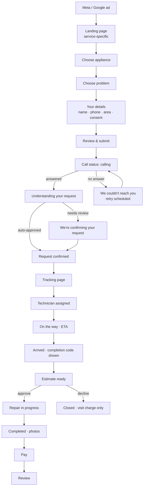
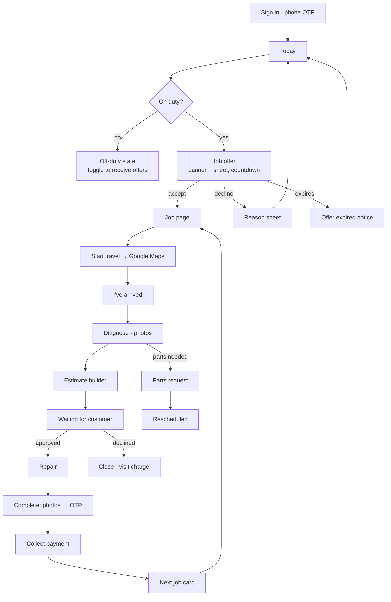
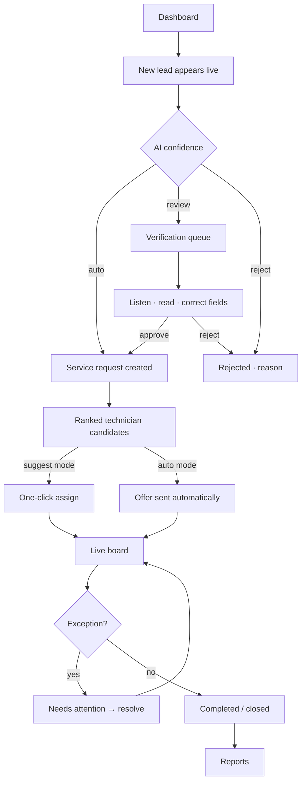

# User Flows

> Status: **Draft for approval.** The flows follow PLAN.md §4 (workflows) and §8 (state machine). Decisions marked **C*n*** refer to the conflict table in [UX-ARCHITECTURE.md §0](UX-ARCHITECTURE.md#0-conflicts-between-the-design-brief-and-planmd).

Each step lists: **Primary action · Secondary action · Must-show information · Likely confusion → design answer.**
Each journey ends with its **state catalogue** (empty / loading / error / failure / success).

---

## 1. Customer journey

### 1.0 Status the customer sees
17 internal statuses collapse into **6 milestones** ([`CUSTOMER_MILESTONES`](../packages/ui/src/tokens/status.ts)):

```text
Request confirmed → Technician assigned → On the way → Inspection & estimate → Repair → Completed
```
Exception statuses (waiting for parts, rescheduled, customer unavailable, unable to repair) show as an **attention** state on the milestone they interrupt, with a plain sentence and the next step.

### 1.1 Flow



### 1.2 Steps

| # | Step | Primary | Secondary | Must show | Likely confusion → answer |
|---|---|---|---|---|---|
| 1 | **Landing page** (from ad, e.g. `/services/ac`) | **Request AC service** | Call us | What we fix, visit charge ("from ₹349"), service area, rating/jobs-done proof, how it works (3 steps) | "Is this a real local business?" → address, phone, real technician photos, reviews |
| 2 | **Choose appliance** (skipped when the ad is service-specific) | Tap a `ServiceCard` (auto-advances) | — | Icons + names + visit-from price | "My appliance isn't listed" → *Other appliance* row → free-text note |
| 3 | **Choose problem** | Tap a `RadioCard` → **Continue** | "I'm not sure", always present | 4–6 common issues for that category (`issue_types`) | Technical terms → plain symptoms ("Runs but not cold"), not "gas leak" |
| 4 | **Your details** | **Continue** | — | Name, mobile (`inputMode=numeric`), area/pincode with autocomplete, call consent checkbox (pre-explained) | "Why do you need my number?" → hint: "We'll call you in about a minute to understand the problem." |
| 5 | **Review & submit** | **Request a call** | Edit any line | Summary of choices + visit charge + "No payment now" + what happens next | "Did I just book?" → button says *Request a call*, not *Book*. Next screen explains (C2) |
| 6 | **Calling you now** | (wait / pick up) | Call us now | Caller number (masked), "about 2 minutes" | "Is this call spam?" → we show the number they'll see |
| 7 | **Understanding your request** | — | — | Calm processing state | Waiting too long → after 20 s: "This can take a minute. We'll WhatsApp you the confirmation." |
| 8 | **Request confirmed** | **Track your service** | Help | SR number, appliance, problem summary, slot window, visit charge | "What now?" → "We're finding your technician. You'll get a WhatsApp when assigned." |
| 9 | **Technician assigned** (tracking) | **Call technician** | Message / Reschedule | `TechnicianCard` (photo, name, specialty, rating), slot, visit charge | "Who is this person?" → identity first, credential only if real (C4) |
| 10 | **On the way** | **Call technician** | Help | Live ETA (`stat-sm`), timeline, "Ravi is on the way" | ETA jumps → show "about", refresh quietly, explain delays in an `Alert` |
| 11 | **Arrived** | — | Help | **Completion code** + "Share it only after the work is done" | "Why a code?" → one-line explanation; code repeated on the completion step |
| 12 | **Estimate ready** | **Approve ₹2,599** | Decline · Ask a question (call) | Itemised lines, total, "Nothing is charged until you approve", warranty note if any | "Is this fair?" → itemised + standard price list. Decline path explicit: "Pay only the visit charge" |
| 13 | **Repair in progress** | — | Call technician | Timeline: Repair (live) | — |
| 14 | **Completed** | **Pay ₹2,599** (Phase 3) / "Pay Ravi directly" (Phase 1, C12) | View invoice | Before/after photos, work summary, amount, invoice | "Did they really fix it?" → photos + timestamps + "Not working? Tell us within 7 days" (needs warranty policy, see §4) |
| 15 | **Payment** | **Pay by UPI** | Pay in cash to technician | Amount = approved estimate, secure-payment note, receipt on WhatsApp | Different amount → always show the breakdown |
| 16 | **Review** | Tap stars (1–5) | Add a comment · Skip | Technician photo + name | Long forms → one tap is enough. Comment optional |

### 1.3 Customer state catalogue

| State | Where | Design |
|---|---|---|
| **Empty** | My services (no past jobs) | "No services yet" + **Request service** |
| **Loading** | Tracking page open | Skeleton of technician card + timeline. Never a spinner on the whole page |
| **Loading** | Address autocomplete | Inline spinner in field; typed text never blocked |
| **Error** | Request submit fails | `Alert` error above the button: "We couldn't send your request. Your details are saved — try again." + **Try again**. Inputs kept |
| **Error** | Tracking link expired | `ErrorState`: "This link has expired" + **Get a new link** (phone OTP) + Call us |
| **Failure** | Call not answered ×3 | `missed`: "We couldn't reach you" + next retry time + **Call us now** / **Call me again** |
| **Failure** | Out of service area | At pincode step: "We don't serve 5000xx yet" + nearest area / **Call us** (don't wait for the call to say no) |
| **Failure** | Lead rejected / duplicate | Duplicate → "You already have a request for your AC (SR-10221)" + **Track it** |
| **Failure** | Technician delayed | `Alert` info on tracking: reason + new ETA |
| **Failure** | Waiting for parts | Attention milestone + expected date + "We'll confirm a new visit time" |
| **Failure** | Customer unavailable | "We missed you" + **Choose a new time** / **Call us** |
| **Failure** | Unable to repair | Plain explanation from technician + visit charge only + next options |
| **Success** | Request confirmed, estimate approved, payment, completion | `pop-in` check + one-line summary + next step |

---

## 2. Technician journey

### 2.0 The single-action principle
On every job status, the **JobActionBar** shows exactly one primary button: the next transition the API allows (`GET /api/meta/transitions`, PLAN §8). Anything unusual goes through one secondary **Problem** button (bottom sheet of reason codes).

| Current status | Primary button | Required input | Taps |
|---|---|---|---|
| OFFERED | **Accept job** (with countdown) | — | 1 |
| ACCEPTED | **Start travel** | — (GPS captured) | 1 |
| EN_ROUTE | **I've arrived** | — | 1 |
| ARRIVED | **Start diagnosis** | — | 1 |
| DIAGNOSING | **Send estimate** / **Start repair** (if within visit charge / pre-approved) | estimate lines | flow |
| AWAITING_ESTIMATE_APPROVAL | (waiting: "Waiting for customer", live) | — | 0 |
| IN_PROGRESS | **Complete job** | after-photo + customer OTP | flow |
| COMPLETED | **Collect payment** | method (cash / UPI link) | 1–2 |

Happy path with no estimate needed: **6 taps + photo + OTP**. Accept → Start travel → Arrived → Start diagnosis → Start repair → Complete.

### 2.1 Flow



### 2.2 Steps

| # | Step | Primary | Secondary | Must show | Likely confusion → answer |
|---|---|---|---|---|---|
| 1 | **Sign in** | **Send code** → auto-read OTP (WebOTP) | Call office | Phone field, language picker (te/hi/en) | Re-login fatigue → long-lived session (PLAN §3) |
| 2 | **Today** | **Next job** hero → Open | Duty switch | Duty status, next job (time, area, appliance), count of jobs, cash to deposit | "Why no jobs?" → empty state tells them to stay on duty |
| 3 | **Job offer** | **Accept** | Decline (reason) | Countdown (e.g. 10:00, tabular), appliance + problem, area + distance, slot, earning (if shown, see §4 Q4) | Missed offers → push + WhatsApp + vibration. Countdown readable and announced |
| 4 | **Job page** | **Start travel** | Call customer · Problem | Customer name, address + landmark, problem + AI summary (no AI badge needed for techs; labelled "Call notes"), appliance history | Wrong address → **Call customer** always 1 tap away |
| 5 | **Navigate** | Opens Google Maps (C6) | — | — | Returning → app resumes on the same job |
| 6 | **Arrived** | **I've arrived** | — | Reminder: "Ask the customer for their completion code at the end" | — |
| 7 | **Diagnosis** | **Send estimate** or **Start repair** | Add photo · Problem | Problem, before-photo slot, visit charge already included | When is an estimate needed? → button logic from API (visit-charge-only jobs skip it) |
| 8 | **Estimate builder** (full-screen) | **Send to customer** | Save draft | Lines from price list (search), labour, parts, total live (`stat`) | Typing on site → price-list picker first, free text second |
| 9 | **Waiting for approval** | — (auto-advances on approval) | Call customer | Live "Waiting for customer", estimate total | Customer hesitant → "Call customer" + resend link |
| 10 | **Parts request** (sheet) | **Request part** | — | Part search / description, qty, photo | Then the job goes to *Waiting for parts*, and the customer is told automatically |
| 11 | **Repair** | **Complete job** | Problem | Timer since start (optional), notes | — |
| 12 | **Completion** (full-screen) | **Confirm completion** | — | After-photo (required), customer OTP field (4 boxes, numeric), work summary | Customer lost code → **Resend code** (SMS/WhatsApp) |
| 13 | **Payment** | **Cash received** / **Send UPI link** | — | Amount = approved estimate, method | Cash vs ledger → toast "₹2,599 added to cash to deposit" |
| 14 | **Next job** | **Start travel** to next | Back to Today | Next job card, travel estimate | — |

### 2.3 Technician state catalogue

| State | Design |
|---|---|
| **Empty**: no jobs today | "No jobs yet today. New offers appear here automatically. Keep your status on duty." |
| **Empty**: off duty | Neutral card + **Go on duty** switch |
| **Loading** | Job card skeletons. Last-known data shown instantly from cache (PWA) |
| **Offline** | Persistent chip "Offline: updates will sync". Status buttons still work (queued). Photos upload on reconnect |
| **Error**: transition rejected (e.g. job was reassigned) | `Alert` error: "This job was reassigned by the office." + **Back to Today**. No dead buttons |
| **Error**: OTP wrong | Field error: "That code doesn't match. Ask the customer to check their WhatsApp." + **Resend code** after 30 s |
| **Error**: photo upload failed | Thumbnail with retry badge. Completion blocked only if *no* photo was ever captured |
| **Failure**: offer expired | Toast "Offer expired: it went to another technician" (no blame) |
| **Failure**: customer unavailable | Problem sheet → reason → auto-notify customer → job moves to *Rescheduled* |
| **Success**: job completed | `pop-in` check + earning added + **Next job** |

---

## 3. Owner / admin journey

### 3.1 Flow



### 3.2 Steps

| # | Step | Primary | Secondary | Must show | Likely confusion → answer |
|---|---|---|---|---|---|
| 1 | **Dashboard** | Act on the top *Needs attention* item | Switch board/date | KPI row (new leads, AI qualified, verification, assigned, in progress, completed, stuck), live board, needs-attention list, technician map | "What do I do first?" → needs-attention is ordered by urgency (SLA breach first) |
| 2 | **New lead** (live) | Open | — | Source/campaign, call status (calling n/3), time since lead | Duplicate leads → merged badge "Duplicate of SR-10221" |
| 3 | **AI confidence** | — | — | Score + band + breakdown + flags (`ConfidenceMeter`) | "Why review this one?" → the failing checks are listed (e.g. *address incomplete*) |
| 4 | **Verification** (split view) | **Approve & create SR** | Edit fields · Call customer · Reject (reason) | Left: audio player + transcript (search, jump to timestamp). Right: extracted fields, uncertain ones highlighted | Trusting AI text → every field links to the transcript moment it came from |
| 5 | **Service request** | — | Edit · Add note · Cancel | SR header (number, status, priority), customer, appliance, address map, AI summary, timeline | — |
| 6 | **Technician candidates** | **Assign [name]** (top candidate) | Choose another · Assign manually | Ranked `TechnicianCard`s with distance, today's load, match score + breakdown | "Why him?" → score breakdown (PLAN §10.2), always visible |
| 7 | **Assignment** | — | Undo (10 s) | Toast "Offered to Ravi. He has 10 min to accept" + countdown on the card | Offer expires → auto-cascade explained in the activity log |
| 8 | **Live monitoring** | Open any card | Filter (technician, area, status) | Board columns by status group, cards with status LED, ETA, SLA timer | Too many cards → saved views + "stuck only" filter |
| 9 | **Exception handling** | The resolving action (Reassign / Call / Reschedule / Approve part) | Snooze · Add note | Reason, time in state, last technician update, AI follow-up attempts | "Did AI already chase this?" → AI follow-ups shown in activity |
| 10 | **Completion** | — | View invoice / payment | Photos, OTP verified ✓, amount, payment status, rating when received | Unpaid → billing filter "Completed · unpaid" |
| 11 | **Analytics** | Change period / campaign | Export CSV | Funnel by campaign, technician performance, AI quality, cost per completed job | — |

### 3.3 Admin state catalogue

| State | Design |
|---|---|
| **Empty**: verification queue | "Verification queue is clear. Leads the AI isn't sure about will show up here." |
| **Empty**: board for a date | "No jobs scheduled for 12 Oct" + **Create request** |
| **Loading** | Table/board skeleton rows. KPIs show skeleton numbers, never "0" while loading |
| **Live-connection lost** (SignalR) | Header chip "Live updates paused · Reconnecting…". Data marked stale after 60 s. **Refresh** |
| **Error**: action failed (e.g. assign conflict, PLAN §7.1 optimistic concurrency) | `Alert`: "Suresh accepted another job a moment ago. Here are the updated candidates." Candidates refresh automatically |
| **Error**: provider outage (WhatsApp/voice) | Dashboard banner `Alert` warning with impact ("Customer messages delayed") + SMS fallback status |
| **Failure**: no technician available (emergency) | Needs-attention, top priority, + **Assign manually** + call list |
| **Success**: SR verified/assigned/closed | Row/card updates in place + toast with **Undo** where reversible |

---

## 4. Open questions surfaced by the flows (for the owner)

1. **Repair warranty.** Is there one (e.g. 30 days on labour)? It changes the completion screen and enables "Not working? Tell us within *n* days".
2. **Estimate threshold for OTP approval** (PLAN §4.4 says "above a threshold"). What amount?
3. **Offer timeout** (PLAN suggests 10 min) and **max offers before escalation**.
4. **Technician earnings visibility.** Show per-job commission to technicians, or only totals?
5. **Customer-visible technician phone.** Direct number or masked/proxy number? (Affects the Call button and privacy.)
6. **Decline-estimate policy.** Visit charge always payable when the estimate is declined?
